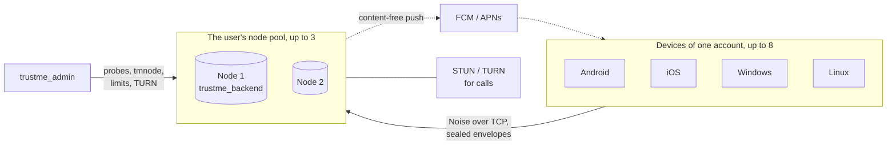

  

<h1 align="center">TrustMe</h1>

  <b>A private messenger with an open server and a trust network.</b> 
  No phone number, up to 8 devices per account, your own nodes.

  
  
  
  

---

This is the overview repository: every part of TrustMe with links in one place. There is no code here.

TrustMe consists of the app, the server node and the node management panel. Messages, files, calls and locations are
encrypted on the device and decrypted only by the recipient; the node passes sealed envelopes along and cannot read them.
You do not have to use the shared server: a node of your own starts with a single command.

## Project map

| Repository | What is inside | Stack | State |
| --- | --- | --- | --- |
| [**TrustMe-releases**](https://github.com/Darkildo/TrustMe-releases) | The app: builds for Android, Windows and Linux (iOS via TestFlight), feature overview, installation, download verification, version history | Flutter | Regular releases, see [Releases](https://github.com/Darkildo/TrustMe-releases/releases) |
| [**trustme_backend**](https://github.com/Darkildo/trustme_backend) | The node: Noise-encrypted channel over TCP, envelope delivery between users and their devices, storage for undelivered messages and files, content-free push wake-ups for offline devices. Protocol, protobuf schemas, deployment guides | Rust | Source is open, see [LICENSING.md](https://github.com/Darkildo/trustme_backend/blob/master/LICENSING.md) |
| [**trustme_admin**](https://github.com/Darkildo/trustme_admin) | Node management panel: external probes, `tmnode doctor` reports from the host, new nodes installed over SSH, limits without restarts, STUN/TURN for calls, users with roles and TOTP | Rust + React | Source is open, see [LICENSING.md](https://github.com/Darkildo/trustme_admin/blob/master/LICENSING.md) |
| Client and cryptographic core | The app's source and the encryption library it is built on | Flutter, Rust + Dart | Being prepared for publication |

## How the parts fit together

- The app keeps sessions on every node of its pool; the primary node receives messages, the others back it up.
- A user's own devices sync with each other through the same nodes, encrypted.
- Files are uploaded to the node as a single encrypted container; the recipient gets only a pointer.
- The management panel talks to nodes through the `tmnode` agent, which needs no inbound port on the node's server.

## Where to start

**I want to use it.** Download the app from [TrustMe-releases](https://github.com/Darkildo/TrustMe-releases/blob/main/README.en.md):
features, installation for every platform and checksum verification are described there.

**I want my own node.** [trustme_backend](https://github.com/Darkildo/trustme_backend#readme) has a Docker Compose setup,
a [deployment guide](https://github.com/Darkildo/trustme_backend/blob/master/docs/deployment.md) and
[runbooks](https://github.com/Darkildo/trustme_backend/tree/master/docs). In the app you only enter the node's address and key.
For a fleet of nodes install [trustme_admin](https://github.com/Darkildo/trustme_admin#readme): it probes the nodes itself and installs new ones over SSH.

**I want to understand the protocol.** The wire format is in
[server-contract.md](https://github.com/Darkildo/trustme_backend/blob/master/server-contract.md),
the schemas in [schemas/](https://github.com/Darkildo/trustme_backend/tree/master/schemas),
the node architecture in [docs/architecture.md](https://github.com/Darkildo/trustme_backend/blob/master/docs/architecture.md).

## Security in brief

- Account: a key pair created on the device from a swipe. No phone number or email.
- Messages, media, location and profile: X25519, AES-256-GCM, Ed25519. Calls: DTLS-SRTP. Channel to the node: Noise.
- Optional in direct chats: forward secrecy based on Double Ratchet.
- Trust network: fingerprint verification in person, contact introductions, per-contact permissions.
- The node sees metadata (who, to whom, when, how large) but not content. More in
  [Security and privacy](https://github.com/Darkildo/TrustMe-releases/blob/main/README.en.md#security-and-privacy).

Report vulnerabilities to the address in the SECURITY.md of the relevant repository, not in public issues.

## Licenses

The app is free and distributed as ready-made builds. The source of the node and the management panel is open; the terms of use,
including commercial use, are in the LICENSING.md of each repository.

## Contact

Questions and ideas: [Discussions](https://github.com/Darkildo/TrustMe-releases/discussions) in the app repository.
Bugs: issues in the repository of the part where they occur. Anything else: didakostya@gmail.com.
