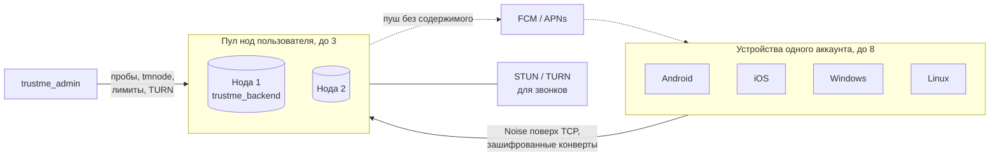

  

<h1 align="center">TrustMe</h1>

  <b>Приватный мессенджер с открытым сервером и сетью доверия.</b> 
  Без номера телефона, до 8 устройств на аккаунт, свои ноды.

  
  
  
  

---

Это обзорный репозиторий: здесь собраны все части TrustMe со ссылками. Кода в нём нет.

TrustMe состоит из приложения, серверной ноды и панели управления нодами. Сообщения, файлы, звонки и местоположение
шифруются на устройстве и расшифровываются только у собеседника; нода пересылает зашифрованные конверты и не может их прочитать.
Общим сервером пользоваться не обязательно: ноду можно поднять у себя одной командой.

## Карта проекта

| Репозиторий | Что внутри | Стек | Состояние |
| --- | --- | --- | --- |
| [**TrustMe-releases**](https://github.com/Darkildo/TrustMe-releases) | Приложение: сборки для Android, Windows и Linux (iOS через TestFlight), описание возможностей, установка, проверка подлинности файлов, история версий | Flutter | Релизы выходят регулярно, [Releases](https://github.com/Darkildo/TrustMe-releases/releases) |
| [**trustme_backend**](https://github.com/Darkildo/trustme_backend) | Нода: шифрованный канал Noise поверх TCP, доставка конвертов между пользователями и их устройствами, хранение недоставленного и файлов, пробуждение офлайн-устройств пушами без содержимого. Протокол, схемы protobuf, инструкции по развёртыванию | Rust | Код открыт, [LICENSING.md](https://github.com/Darkildo/trustme_backend/blob/master/LICENSING.md) |
| [**trustme_admin**](https://github.com/Darkildo/trustme_admin) | Панель управления нодами: пробы снаружи, отчёты `tmnode doctor` с хоста, установка новых нод по SSH, лимиты без перезапуска, STUN/TURN для звонков, пользователи с ролями и TOTP | Rust + React | Код открыт, [LICENSING.md](https://github.com/Darkildo/trustme_admin/blob/master/LICENSING.md) |
| Клиент и криптографическое ядро | Исходный код приложения и библиотеки шифрования, на которой оно построено | Flutter, Rust + Dart | Готовятся к публикации |

## Как части связаны

- Приложение держит сессии на всех нодах своего пула; главная нода принимает сообщения, остальные подстраховывают.
- Свои устройства синхронизируются между собой через те же ноды, в зашифрованном виде.
- Файлы загружаются на ноду одним зашифрованным контейнером, собеседнику уходит только указатель.
- Панель управления общается с нодами через агент `tmnode`, которому не нужен ни один входящий порт на сервере ноды.

## С чего начать

**Хочу пользоваться.** Скачайте приложение на странице [TrustMe-releases](https://github.com/Darkildo/TrustMe-releases#readme):
там же описаны возможности, установка на каждую платформу и проверка контрольных сумм.

**Хочу свою ноду.** В [trustme_backend](https://github.com/Darkildo/trustme_backend#readme) есть запуск через Docker Compose,
[описание развёртывания](https://github.com/Darkildo/trustme_backend/blob/master/docs/deployment.md) и
[runbook'и](https://github.com/Darkildo/trustme_backend/tree/master/docs). В приложении достаточно указать адрес ноды и её ключ.
Для парка нод поставьте [trustme_admin](https://github.com/Darkildo/trustme_admin#readme): он сам проверяет ноды и ставит новые по SSH.

**Хочу разобраться в протоколе.** Формат обмена описан в
[server-contract.md](https://github.com/Darkildo/trustme_backend/blob/master/server-contract.md),
схемы в [schemas/](https://github.com/Darkildo/trustme_backend/tree/master/schemas),
архитектура ноды в [docs/architecture.md](https://github.com/Darkildo/trustme_backend/blob/master/docs/architecture.md).

## Безопасность в двух словах

- Аккаунт: пара ключей, созданная на устройстве из движения пальцем. Номер телефона и почта не нужны.
- Сообщения, медиа, геолокация и профиль: X25519, AES-256-GCM, Ed25519. Звонки: DTLS-SRTP. Канал до ноды: Noise.
- По желанию в личных чатах: защита прошлых сообщений на основе Double Ratchet.
- Сеть доверия: сверка отпечатков при встрече, рекомендации контактов, права для каждого контакта отдельно.
- Нода видит метаданные (кто, кому, когда, какого размера), но не содержимое. Подробнее в разделе
  [«Безопасность и приватность»](https://github.com/Darkildo/TrustMe-releases#безопасность-и-приватность).

Об уязвимостях пишите по адресу из SECURITY.md соответствующего репозитория, а не в публичные issue.

## Лицензии

Приложение бесплатно и распространяется готовыми сборками. Код ноды и панели управления открыт; условия использования,
включая коммерческое, описаны в файлах LICENSING.md каждого репозитория.

## Связь

Вопросы и идеи: [Discussions](https://github.com/Darkildo/TrustMe-releases/discussions) в репозитории приложения.
Ошибки: issues в репозитории той части, где они возникли. Остальное: didakostya@gmail.com.
